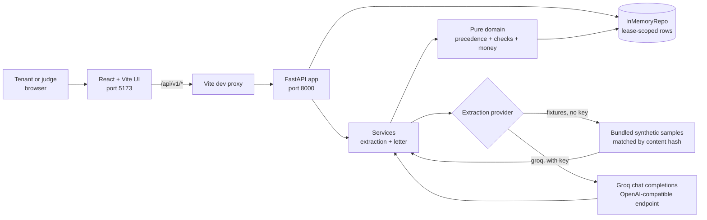
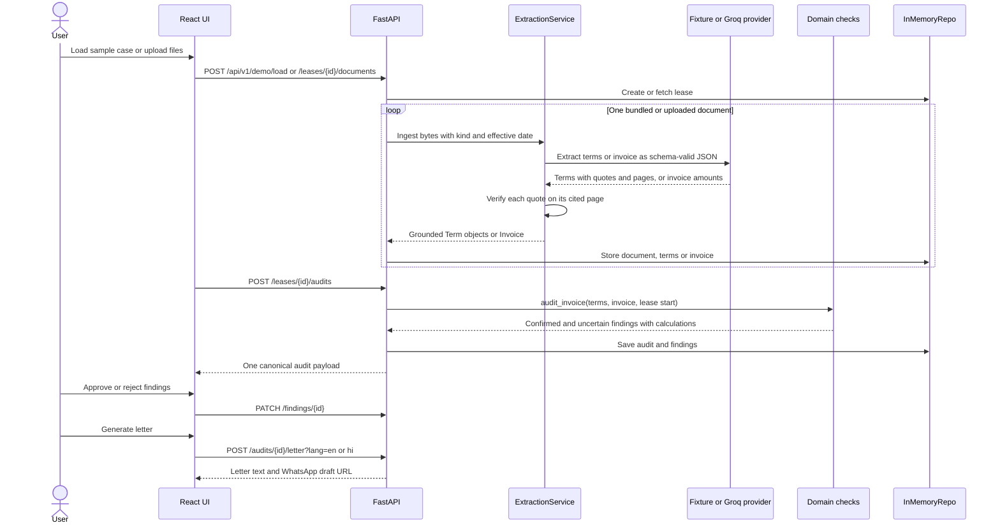
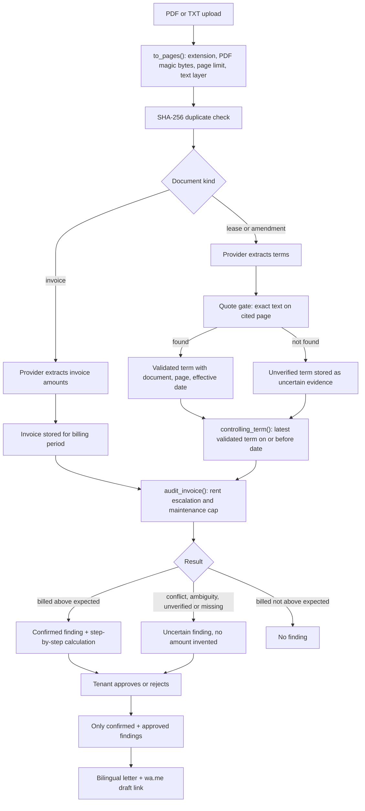
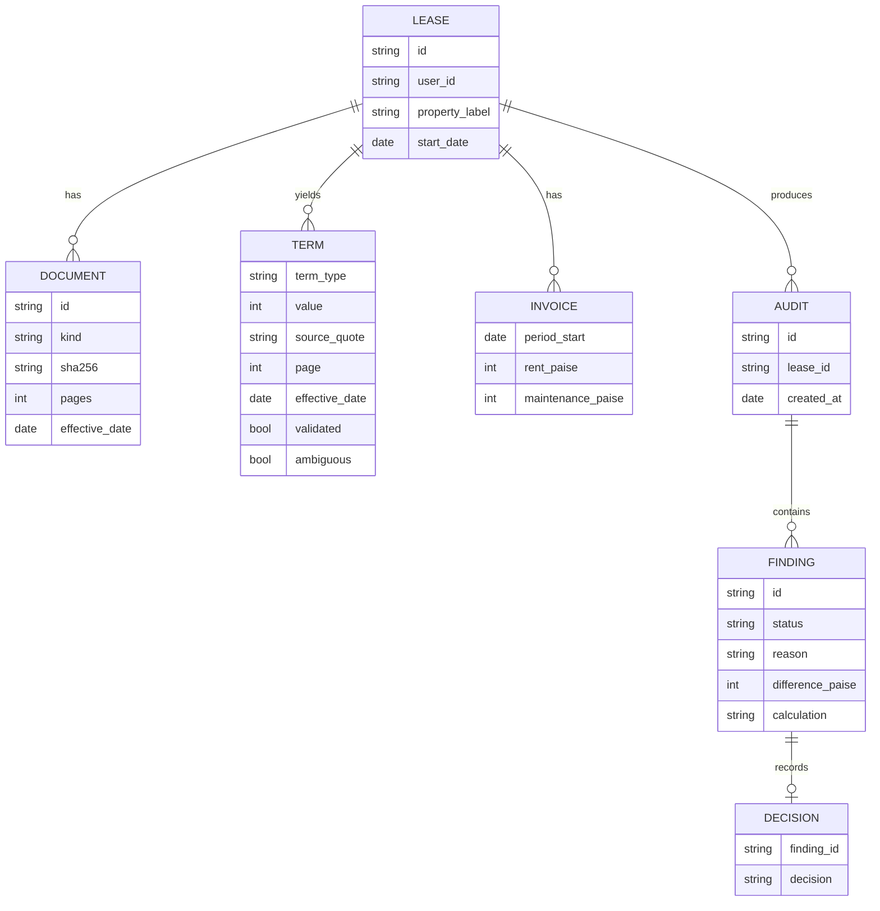
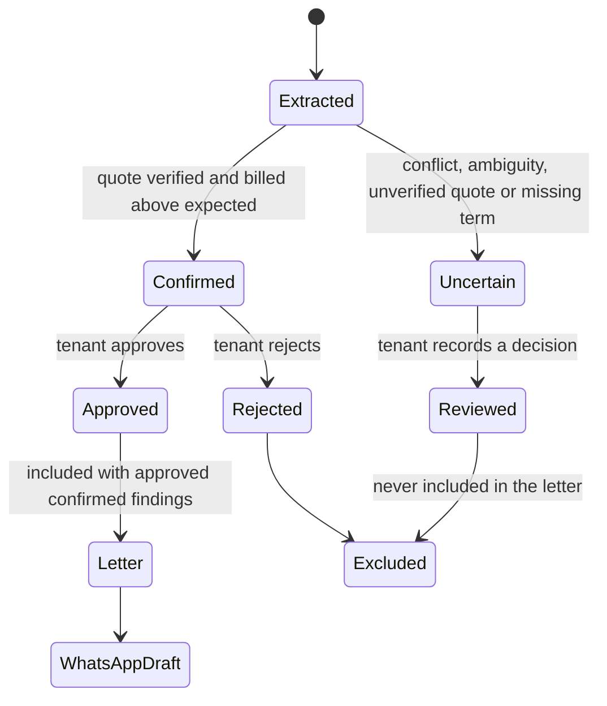

# LeaseGuard — evidence-first lease charge audit

**Team Techbeez** · Amritanshu Mishra · Kaushiki Upadhaya

LeaseGuard is a bilingual (English / हिंदी) hackathon app that compares a tenant's invoice with a lease and its amendments. The AI reads and extracts clauses; deterministic Python code decides which amendment controls, recomputes the charges in integer paise, and shows the evidence behind every flagged difference. It opens a WhatsApp **draft** for sharing — it never sends a message and never claims money was recovered.

> All bundled documents are **synthetic demo data** derived from the supplied technical specification. No real tenant documents or personal data are used. See [`docs/synthetic-data.md`](docs/synthetic-data.md).

---

## 0. Where things are

| Thing | Location |
| --- | --- |
| Repository branch | `arena/e36129fa-leaseguard` |
| Backend | `backend/` — FastAPI on `http://localhost:8000`; interactive docs at `/docs` |
| Frontend | `frontend/` — React + Vite on `http://localhost:5173` |
| Groq key file | `backend/.env` — git-ignored, **not** the repo root, **not** `frontend/` |
| In-app setup guide | Key icon in the app header |
| Final 2-minute demo script | [`docs/demo-video-script.md`](docs/demo-video-script.md) |

### Open the live preview in Arena

While this Arena session is live, the app is already running:

1. Open the **Live Preview** panel in Arena for the running “Website” process on port **5173**.
2. Click **Open in new tab** to record in a normal browser tab.
3. You should see **“Check your rent before you pay.”**, a **Load sample case** button, and the footer **Techbeez · Amritanshu Mishra · Kaushiki Upadhaya**. The **Demo mode** badge is expected.
4. If you pasted a bare `https://5173-….e2b.app` URL and saw **“traffic token missing”**, close it. That address is token-gated; only the URL generated by Arena’s **Open in new tab** button includes the required traffic token.
5. Do **not** use `http://localhost:5173` on your laptop — that points to your laptop, not this sandbox. Port **8000** is the API; only port 5173 is the app.

---

## 1. The problem and the design rule

A shopkeeper sends a monthly bill. The tenant has a lease and one or more amendments, often with conflicting escalation clauses. Manually checking which clause was in force on the billing date is slow and error-prone.

LeaseGuard follows one rule everywhere:

> **The model reads. The code decides.**

The language model only extracts facts with a verbatim quote and page number. Strict Pydantic schemas, a quote-verification gate and deterministic domain functions do the rest. The model never computes an amount, never chooses the controlling amendment, and never writes the letter's conclusions.

Four consequences:

1. **Evidence or uncertainty.** A term without a verified quote on the cited page cannot become a fact.
2. **Precedence by effective date.** The latest validated term on or before the relevant date wins; same-date disagreements become a conflict, not a silent choice.
3. **Integer paise.** All money is `int` paise with half-up integer division — no floating-point amounts.
4. **Share, don't send.** Findings require tenant approval; the letter opens a WhatsApp draft that the tenant decides whether to send.

---

## 2. Architecture

### 2.1 High-level architecture



The browser never calls a `localhost` backend from the preview. It calls same-origin `/api/v1/*`; Vite forwards those requests to FastAPI. CORS is configured as a secondary path for direct API access.

### 2.2 End-to-end request sequence



### 2.3 Audit pipeline flowchart



### 2.4 Data model



The diagram is conceptual: the current repository stores these as dictionaries in `InMemoryRepo`, not as SQL tables. Every lease-scoped read is filtered by `user_id`; a foreign lease returns the same 404 as a missing one.

### 2.5 Finding lifecycle



### 2.6 Layer responsibilities

| Layer | Files | Rule |
| --- | --- | --- |
| HTTP API | `backend/app/api/main.py` | Validate, authorise, call services, map errors. No business logic. |
| Services | `backend/app/services/` | Extraction + quote gate; deterministic bilingual letters. |
| Domain | `backend/app/domain/` | Pure dataclasses and functions: precedence, checks, money, impact. |
| Infrastructure | `backend/app/infra/` | Groq/fixture adapters, PDF/TXT parsing, in-memory repository. |
| Contracts | `backend/app/schemas.py` | Strict Pydantic models with `extra="forbid"` for model output and request bodies. |
| Demo catalogue | `backend/app/demo.py` | Six labelled scenarios composed from bundled samples at request time. |
| UI pages | `frontend/src/pages/` | Dashboard, lease detail, audit, letter and help. |
| UI components | `frontend/src/components/` | Upload, evidence, impact, status, setup modal, layout and error boundary. |
| API client | `frontend/src/api/client.ts` | Typed calls to `/api/v1`; one place for the base path and error shape. |
| Translations | `frontend/src/i18n/index.ts` | Single EN/HI dictionary for screens, buttons, findings and errors. |

---

## 3. What is implemented

### 3.1 Upload and extraction

- `.pdf` and `.txt` only; PDF magic bytes are checked and text layer is required. Scanned PDFs are rejected with a clear message — **no OCR in this build**.
- Default limits: **10 MB** per file and **50 pages** (`MAX_UPLOAD_MB`, `MAX_PAGES`).
- Duplicate SHA-256 uploads to the same lease return `409`.
- A lease document's effective date corrects a placeholder tenancy start date, so anniversaries are computed from evidence.
- **Fixture mode** recognises bundled samples by content fingerprint, so renamed files and PDF/TXT twins both work without a key. Unknown files are rejected rather than guessed.
- **Groq mode** sends page-tagged document text as data inside a fixed instruction frame, requests JSON, validates it against Pydantic schemas, and retries once with validation feedback.

### 3.2 Grounding and precedence

- Every extracted term must be quoted verbatim (whitespace-normalised) on the **cited page**; otherwise `validated=false`.
- `controlling_term()` has five explicit outcomes: `Controlling`, `Missing`, `Unverified`, `Conflict`, `Ambiguous`.
- Effective dates are applied per anniversary for escalation and at the invoice period start for the maintenance cap.
- Future amendments are ignored; same-date conflicting amendments are both shown.

### 3.3 Checks and evidence

Two deterministic checks are implemented:

| Check | Logic |
| --- | --- |
| `rent_escalation` | Base rent, then one escalation per completed anniversary using the controlling basis points; compare to billed rent. |
| `maintenance_cap` | Compare billed maintenance to the controlling flat monthly cap. |

Confirmed findings include billed, expected, difference, source terms and ordered calculation steps. Each evidence row shows the clause quote, document, page and effective date. Uncertain findings show the relevant clauses/reason and deliberately leave the amount empty.

### 3.4 Decisions, impact and letter

- `PATCH /findings/{id}` records `approved` or `rejected`; the audit refresh endpoint reflects it immediately.
- Impact fields: **excess detected**, **awaiting your review**, **estimated minutes saved**, plus counts and an explicit disclaimer. Time saved is `3 × documents + 5 × audits`, labelled illustrative, not measured.
- The letter includes only **confirmed + approved** findings, is generated in English or Hindi, and returns a `https://wa.me/?text=` draft link. It also exposes copy-text, copy-link, native share and an `api.whatsapp.com` alternate link. Nothing is sent automatically.

### 3.5 Bilingual and demo experience

- Header EN/हिंदी toggle; translated buttons, errors, findings, evidence, impacts and letter.
- Header key icon opens the bilingual Groq setup guide.
- Six selectable synthetic scenarios are assembled dynamically through the real upload/extract/audit path — see §6.
- The `Use a bundled sample` button works in demo mode even for a manually created lease.

---

## 4. Project layout

```text
leaseguard_
├── backend/
│   ├── app/
│   │   ├── api/main.py           # HTTP routes and canonical response shaping
│   │   ├── core/config.py        # env-backed settings, .env loader
│   │   ├── domain/               # checks, precedence, money, impact, models, quotes
│   │   ├── infra/                # Groq/fixture adapters, text extraction, repo
│   │   ├── services/             # extraction service, letter builder
│   │   ├── demo.py               # six-scenario catalogue
│   │   └── schemas.py            # Pydantic contracts
│   ├── samples/                  # synthetic TXT + PDF twins
│   ├── samples/fixtures/         # content-hash extraction fixtures
│   ├── scripts/                  # sample builder, key helper, smoke tests
│   └── tests/                    # 44 backend tests
├── frontend/
│   ├── src/pages/                # Dashboard, LeaseDetail, Audit, Letter, Help
│   ├── src/components/           # UploadPanel, EvidencePanel, ImpactStrip, modals
│   ├── src/api/                  # typed client, types, money/date formatters
│   ├── src/i18n/index.ts         # EN/HI dictionary
│   └── src/styles.css            # responsive design system
├── docs/                         # architecture, synthetic data, checklist, video script
├── .github/workflows/ci.yml      # lint, tests, typecheck, build, pipeline smoke
├── setup_laptop.sh               # macOS/Linux one-command setup
└── setup_laptop.ps1              # Windows PowerShell one-command setup
```

### Technology

Backend: Python 3.11, FastAPI, Pydantic 2, pypdf, `openai` SDK pointed at Groq, pytest, ruff.  
Frontend: Node 18+ (CI uses Node 20), React 18, TypeScript, Vite 5, Vitest, Testing Library, lucide-react.

---

## 5. HTTP API

All application routes are under `/api/v1`; `/health` is unversioned. Interactive docs: `http://localhost:8000/docs`.

| Method | Path | Purpose |
| --- | --- | --- |
| `GET` | `/health` | Liveness and provider name |
| `GET` | `/api/v1/config` | Provider, live flag, model, json mode, upload limit, key status |
| `POST` | `/api/v1/leases` | Create a lease |
| `PATCH` | `/api/v1/leases/{lease_id}` | Edit property label or start date |
| `GET` | `/api/v1/leases` | List the current user's leases |
| `GET` | `/api/v1/leases/{lease_id}` | Lease with documents, terms and invoices |
| `DELETE` | `/api/v1/leases/{lease_id}` | Delete lease and related audit data |
| `POST` | `/api/v1/leases/{lease_id}/documents` | Upload lease, amendment or invoice file |
| `POST` | `/api/v1/leases/{lease_id}/demo/documents` | Attach a bundled sample in either mode |
| `GET` | `/api/v1/demo/scenarios` | Bilingual scenario catalogue |
| `POST` | `/api/v1/demo/load?scenario=…` | Compose a scenario through the real pipeline |
| `GET` | `/api/v1/leases/{lease_id}/terms` | Extracted terms |
| `POST` | `/api/v1/leases/{lease_id}/audits` | Run audit |
| `GET` | `/api/v1/audits/{audit_id}` | Refresh the same canonical audit payload |
| `PATCH` | `/api/v1/findings/{finding_id}` | Approve or reject a finding |
| `POST` | `/api/v1/audits/{audit_id}/letter?lang=en\|hi` | Build letter and WhatsApp draft |
| `GET` | `/api/v1/impact` | Overall user-scoped impact |
| `GET` | `/api/v1/leases/{lease_id}/impact` | Lease-level impact |

Errors use `{"error": {"code": "...", "message": "..."}}`. Missing and foreign rows both return `404`.

---

## 6. Six synthetic scenarios

These are declared in `backend/app/demo.py` and composed from bundled files at request time. Expected outcomes are machine-checked in tests and in the pipeline smoke script.

| ID | Label | What it demonstrates | Expected result |
| --- | --- | --- | --- |
| `amendment` | Amendment controls | Lease 10% vs January amendment 5%; April invoice still uses 10% | 2 confirmed · ₹3,200 excess |
| `ambiguous` | Unclear clause | “A reasonable increase” has no usable number | 1 uncertain + ₹1,200 maintenance excess |
| `conflict` | Conflicting amendments | 5% and 7% amendments effective the same day | Conflict flagged + ₹1,200 maintenance excess |
| `future` | Amendment not yet due | 5% amendment starts in July; April uses lease rate | No findings |
| `missing-cap` | Missing maintenance cap | No cap in documents | Uncertain · no amount invented |
| `clean` | Clean invoice | 5% amendment and matching invoice | No findings |

The default case in the video is `amendment`: billed rent ₹44,000, expected ₹42,000 (₹2,000 excess); billed maintenance ₹5,200, cap ₹4,000 (₹1,200 excess); total **₹3,200**.

---

## 7. Run it

### 7.1 No-key demo (what the video uses)

```bash
# Terminal 1 — API
cd backend
python -m venv .venv
source .venv/bin/activate          # Windows: .venv\Scripts\activate
pip install -r requirements.txt
uvicorn app.api.main:app --host 0.0.0.0 --port 8000

# Terminal 2 — UI
cd frontend
npm ci                             # or npm install
npm run dev
```

Open `http://localhost:5173`. Press **Load sample case / सैंपल केस लोड करें**, then **Run invoice audit / बिल की जाँच करें**. Fixture mode is selected automatically when no usable Groq key is configured.

### 7.2 One-command laptop setup

```bash
# macOS / Linux
bash setup_laptop.sh

# Windows PowerShell, from the repo root
powershell -ExecutionPolicy Bypass -File setup_laptop.ps1
```

If PowerShell says **“'vite' is not recognized”**, dependencies were not installed. Run `npm ci` inside `frontend/` first, or run the setup script above. If `npm` itself is missing, install Node 18+ from <https://nodejs.org> and open a new terminal.

### 7.3 Groq mode

No key is stored in source code. The secure helper prompts invisibly and writes only `backend/.env`:

```bash
cd backend
python -m scripts.set_groq_key
```

It asks for a **current** model ID from <https://console.groq.com/docs/models> (for example `openai/gpt-oss-20b`) and sets:

```dotenv
EXTRACTION_PROVIDER=groq
LLM_API_KEY=gsk_...
EXTRACTION_MODEL=openai/gpt-oss-20b
EXTRACTION_JSON_MODE=object
```

Restart the API after changing `.env`, then run:

```bash
cd backend
python -m scripts.smoke_groq
```

| Variable | Default | Meaning |
| --- | --- | --- |
| `EXTRACTION_PROVIDER` | `fixtures` | `fixtures` or `groq` |
| `LLM_API_KEY` | empty | Groq key; required for `groq` |
| `EXTRACTION_MODEL` | empty | Current Groq model ID; required for `groq` |
| `EXTRACTION_JSON_MODE` | `object` | `object` JSON mode or `schema` if the chosen model supports it |
| `ALLOWED_ORIGINS` | `http://localhost:5173` | Comma-separated CORS origins; Arena `*.e2b.app` origins are allowed too |
| `MAX_UPLOAD_MB` | `10` | Per-file upload cap |
| `MAX_PAGES` | `50` | Page cap after parsing |

If Groq client construction fails, the API falls back to fixture mode and exposes the reason in `/api/v1/config` and the UI strip. No model ID is hard-coded in the application.

---

## 8. Verification

```bash
cd backend
ruff check .
python -m pytest -q
python -m scripts.smoke_pipeline        # against a running API, no key needed

cd ../frontend
npm run typecheck
npm test
npm run build
```

Last verified results in this workspace:

- `ruff check .` clean.
- **44 backend tests passed** (one harmless Starlette/TestClient deprecation warning).
- **10 frontend tests passed** across formatting, i18n, API base path, dashboard, audit, letter, setup modal, decisions and scenario picker.
- `npm run typecheck` and `npm run build` clean.
- `smoke_pipeline.py` prints **`PIPELINE OK — ready for demo.`** after checking health, uploads, quote validation, both differences, canonical GET/POST audit shape, decision-aware impact, EN/HI letters, WhatsApp links, delete and all six scenarios.

CI on every push runs backend lint/tests/pipeline smoke and frontend typecheck/tests/build: [`.github/workflows/ci.yml`](.github/workflows/ci.yml).

---

## 9. Demo video

Use [`docs/demo-video-script.md`](docs/demo-video-script.md). It contains:

- How to open the Arena live preview.
- Four screen-recording options.
- A word-for-word 2-minute script for **Techbeez — Amritanshu Mishra, Kaushiki Upadhaya**.
- A one-minute fallback and WhatsApp fallback steps.

---

## 10. Honest limits — what this build does **not** claim

1. **No live Groq call has been verified with a real key in this workspace.** The adapter is unit-tested with a fake OpenAI-compatible client; `python -m scripts.smoke_groq` is the remaining check on a machine with a real key.
2. **No database.** `InMemoryRepo` keeps data in process memory. Restarting the API clears leases and audits.
3. **No real accounts.** One documented `demo-user` is used. Reads are user-scoped, but there is no JWT or login.
4. **No OCR.** Only text-layer PDFs and TXT files work; scanned PDFs are rejected.
5. **Two checks only.** Rent escalation and maintenance cap. Other lease charges are out of scope.
6. **No legal advice.** The letter says the items are for review, not legal conclusions.
7. **No money recovered.** The app detects and totals differences for review. It does not collect, refund or send money.
8. **No automatic WhatsApp sending.** It opens a `wa.me` draft; the tenant decides whether to send.
9. **No permanent deployment.** The Arena preview URL is temporary while this session is live; local instructions are in §7.
10. **No browser end-to-end test.** Playwright's browser download failed in this environment, so UI verification is via Vitest component tests, typecheck, build and live API proxy checks.
11. **No claim about how often tenants are overcharged.** The supplied premise is an unverified hypothesis; this app demonstrates a workflow, not a prevalence finding.

---

## 11. Documents index

| Document | Contents |
| --- | --- |
| [`docs/architecture.md`](docs/architecture.md) | Layer rules, request flow and engineering decisions |
| [`docs/synthetic-data.md`](docs/synthetic-data.md) | Provenance of every bundled sample and fixture |
| [`docs/submission-checklist.md`](docs/submission-checklist.md) | Requirement-by-requirement status |
| [`docs/demo-video-script.md`](docs/demo-video-script.md) | Final recording script, credits and preview instructions |
| [`docs/LeaseGuard_Demo_Script_and_Instructions.docx`](docs/LeaseGuard_Demo_Script_and_Instructions.docx) | Downloadable Word version of the script and instructions |
